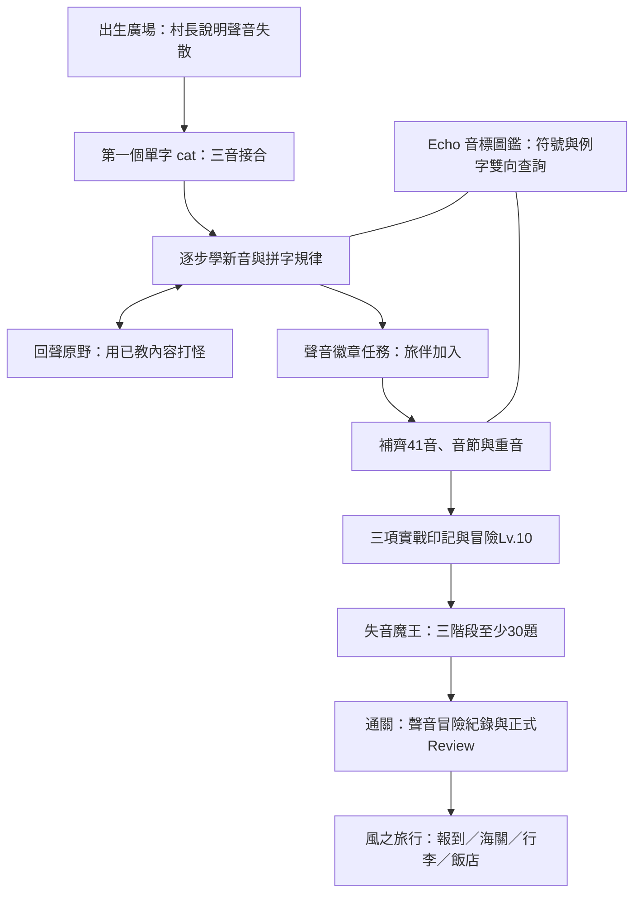

# 音之新手村：產品與教學規劃 v1

狀態：**開發規格，非已完成功能**。這份文件統整使用者最新決定；取代早期「只教幾組音即可畢業」「旅行行李任務才取得旅伴」的安排。程式由 Claude 開發，ChatGPT 負責課程、玩法、美術方向與驗收規劃；使用者試玩確認。只先完成新手村到風之旅行，不擴大世界範圍。

## 1. 這關真正要教會什麼

玩家能區分字母名字、拼字與語音；聽到已學過的聲音能選對 KK 符號；知道一個聲音可能由不同拼字表示、相同拼字也可能有不同讀法；能把聲音接成短單字，再辨認音節與重音。

課程常用 KK 清單為 17 母音 + 24 子音。不是 26 個英文字母的一對一轉換表。/j/ 是 yes 的起音，不是字母 J 的名字；/e/、/o/ 的示範需符合本課程採用的美式聲音與 KK 記法，不以中文諧音取代。

第一次完成課程、答對、接受協助、熟練，必須是不同狀態。村口畢業代表完成入門實戰，不宣稱已能準確發出所有音，也不換算成多益分數。

## 2. 玩家旅程與空間

全程滿版 RPG；教學、作答、字卡都在場景內浮層。常駐只保留 HP／MP、目前目標、選單與一個主要互動動作。

地點：出生廣場、聲音學堂、組音工坊、回聲原野（分區）、失音遺跡。學堂與原野有路線標記，可用主要動作前往目標。遇到未開區域說明缺哪個任務，不只顯示鎖。

## 3. NPC 分工

| NPC | 負責內容 | 互動原則 |
|---|---|---|
| 村長 Kai | 開場、階段任務、魔王資格、畢業 | 一次只交付一個清楚目標 |
| **新增 Echo：音標圖鑑老師** | 完整41音目錄；查音找例字、查字拆聲音 | 全部音可預覽，教學進度與戰鬥題池分開 |
| 母音老師 Ava | 17母音、嘴形與辨音 | 每個小單元1–3音，聽例字再練 |
| 子音老師 Cody | 24子音、舌位氣流及拼字組合 | 對比有聲／無聲與相近音 |
| 重音老師 Stella | 音節、重音、弱讀 | 使用核對過的例字，不只從字串猜音節 |
| 旅伴露米 | 當題糾正、戰鬥支援、簡短生活對話 | 完成任務才加入，不作攻擊對象 |

Echo 是查詢與教學入口，不是另一份獨立題庫。與老師、戰鬥、開車模式共用音素／詞彙／錄音 ID。

## 4. 課程先後順序與41音覆蓋

以下是章節，不是一次把整排音塞進畫面。每章再拆成1–3音的小單元；已教音會在組音任務中使用。教學首次的檢查與當題糾正不叫正式 review；正式錯題複習入口在畢業後開。

| 章節 ID | 新內容 | 累計不同音 | 典型實際運用 |
|---|---|---:|---|
| N00 聲音入門 | 字母名字、單字拼字、KK各自代表什麼；ABC辨認可補學 | 0 | 看 cat，聽整字；不要先考符號 |
| N01 第一個字 | /k æ t/ | 3 | c→/k/、a→/æ/、t→/t/；慢接再正常念cat |
| N02 聲音小路 | /m n s f/ | 7 | 聽辨起音、尾音；和已教音接合 |
| N03 子音工具箱 | /p b d g h l/ | 13 | 有聲／無聲與簡單拼字例字；可拼map |
| N04 短母音擴充 | /ɛ ɪ ɑ ʌ/ | 17 | cat、egg、fish、sun等，短字辨音與組合 |
| N05 圓唇與口形 | /ʊ ɔ/ | 19 | book等示範；/ɔ/選用與課程一致的錄音 |
| N06 常見母音與拼字 | /i u e o/ | 23 | ee、oo、a-e、o-e；tree/moon/cake/phone |
| N07 氣流與振動 | /v z θ ð/ | 27 | f/v、s/z、th兩種音的對比 |
| N08 組合子音 | /ʃ ʒ tʃ dʒ/ | 31 | sh、ch及其他例字中的拼字；不把字母J念成/j/ |
| N09 舌位與滑動 | /ŋ r w j/ | 35 | sing、rain、water、yes等；/ŋ/不硬加/g/ |
| N10 雙母音 | /aɪ aʊ ɔɪ/ | 38 | bike、house、boy等；觀察聲音的滑動 |
| N11 弱母音與捲舌母音 | /ə ɝ ɚ/ | **41** | banana、bird、teacher；連結輕重讀 |
| N12 音節與重音 | 不新增核心音；介紹ˋ、ˏ及必要的成音節子音記法 | 41 | apple、banana等，區分音節和字母數 |
| N13 組音實戰 | 已教音與拼字規律的混合應用 | 41 | 補音標位置、聽整字拆音、看熟悉圖片組音 |

i-e 固定在 N10 與 /aɪ/ 一起教，之前不當作獨立判分目標。所有章節均遵守：例字可以含尚未評量的聲音，但**被問到的目標音只能是已教過的音**。組整字時必須確認所有需要選入的音都已教。

拼字規律依例字呈現：同音不同拼字（fish的f／phone的ph）、同拼字不同音（moon／book的oo）、字尾e、c與g的常見變化、不發音字母。不宣稱規則涵蓋所有單字。進階例外放在例字說明，初期不一次展開。

## 5. 每個音的固定教學循環

1. **聽聲音**：可先點一下聽，再顯示符號。單音錄音與整字示範明確分開。
2. **看怎麼發**：簡短口形／舌位提示，搭配一個清楚圖示；不使用錯誤的中文諧音口訣。
3. **看怎麼寫**：顯示 KK 與例字中對應拼字，例如fish的sh。不是每次都顯示整個難字。
4. **聽例字**：至少兩個經核對的例字；每個字可反覆點來聽。
5. **做首次辨認**：先播聲音，再顯示2–3個音標選項；教學不限時。
6. **接起來用**：有足夠已教音後才組短字、接原野任務。

小單元完成條件：每個新音至少有一次無提示的正確辨認；對比單元需兩個音都各自成功，不能只會其中一個。組音單元至少獨立完成一個全由已教音構成的單字。提示／協助記為練習，不能充當上述條件；達題量上限則保存未完成，下次接續，不清掉已達標部分。

每小節約1–3分鐘只是規劃估計，需試玩調校。可隨時休息；回來接續，不重播全部開場。從一開始就讓人完成小任務，不等41音全教完才開始遊戲。

## 6. Echo 的兩個核心入口

### A. 選一個音：它常出現在哪些字？

例如 /æ/：發音方式、常見拼字a、cat/apple/map；點例字播整字並標出對應部分。另提供與/ɛ/比較的入口。先教學，可選「開始練習」；不打開面板就突然倒數。

### B. 選一個字：它是哪些聲音組起來的？

例如fish：f→/f/、i→/ɪ/、sh→/ʃ/，顯示/fɪʃ/，可聽單音、慢速接合及整字正常速度。每種按鈕要正確說明實際播放什麼。

搜尋／分類只使用已整理的詞庫。沒有核對過的拆解不能由字母規則猜出來；缺KK或音檔就明示缺項。可用圖鑑表找字，也能在地圖任何已顯示單字上開啟其卡片。

## 7. 兩種題型與答案揭曉

| | 聽音選音標 | 看圖組音標 |
|---|---|---|
| 先提供 | 聲音；不放目標拼字、圖片、完整答案 | 熟悉、意思明確的圖片；不先念答案 |
| 再提供 | 播完才顯示KK候選，戰鬥才倒數 | 空格和可選音標；組完整字算一題 |
| 玩家操作 | 選音標確認 | 把音標選入位置後確認 |
| 答對 | 揭曉符號／單字、播放正常發音、攻擊 | 揭曉拼字／完整音標、播放發音、攻擊 |
| 答錯 | 受擊；不立即亮出正確選項 | 受擊；錯位置保持未完成 |
| 協助 | 玩家主動選夥伴提示／示範才補正 | 指出錯音、可重聽，再由夥伴協助放入 |

暫選、確認、獨立正確、錯誤、超時、協助完成是不同事件。候選中有正確符號是正常出題，但不能預先標正解；題幹、提示、圖片標籤與aria-label都不能洩漏。

首次答對才算獨立表現；夥伴補正不追加同題攻擊或再次發XP。超時會受戰鬥傷害，但與真正辨音錯誤分開記錄。音訊故障不算超時或英文答錯。

音訊未成功播完不開始倒數；主動重播、夥伴解說、開選單、切背景都凍結，返回明確續答。每題只有一次傷害／記錄結算。

## 8. 原野：至少五種普通怪，不只一隻泡泡

數字為試玩起始值，需與玩家傷害一起平衡；怪物等級不決定題庫英文難度。各區有多隻同類與少量混合怪，未教內容不得被隨機抽到。

| 怪物 | HP | 區域／解鎖 | 玩法 |
|---|---:|---|---|
| 回音泡泡 | 24 | N01後的入口草地 | 聽已教音辨認，時間長、傷害低 |
| 苔球精 | 40 | N04後的短字坡 | 用熟悉圖片組已教短字 |
| 旋風雀 | 55 | N06後的聽風台 | 近似音辨識，答對阻止衝刺 |
| 岩甲龜 | 80 | N09後的回聲洞口 | 答對破盾，再用組音攻擊 |
| 鼓點石靈 | 100 | N12後的節奏石陣 | 聽單字找重音，辨認節奏 |

首輪任務：辨音印記（聽辨）、組音印記（短字組合）、節奏印記（音節／重音）。與課程並行，避免先做一長串選擇題才有遊戲。

重複打怪可取得少量補給與裝飾，但不能靠刷同一題跳過教學。早期主要學習壓力來自內容，不靠低掉落率、稀有怪、MP短缺或長距離跑圖拖時間。

## 9. 旅伴加入：在新手村魔王之前

N06後觸發「修好聲音徽章」：露米的聲音碎片散在原野，玩家用map、book、cake等已教音修復三個碎片。露米恢復後主動邀請同行。完成任務才取得；不同故事解法都能加入。

第一版能力：每題錯誤後可請牠比較聲音、示範正解並協助補正；每場一次排除選項；連答蓄能護盾。提示動畫／語音期間停倒數。初期不再增加太多按鈕；不讓旅伴替玩家自動清題。

玩家與露米可練3–5輪短對話。初期可用中文劇情與英文示範，不考未教的音；後續生活情境與開車模式共用題庫。友情成長來自對話和共同任務，沒有飢餓、斷登入懲罰。

舊玩家已取得露米者，保留持有、默契與外觀。還沒取得者改走新手村邀請／補領入口；旅行行李任務改為共同任務，不重複送第二位露米。

## 10. 冒險等級與魔王資格

**冒險等級獨立於語言程度與多益。** 不可使用目前8000學習XP才到的B2+等級直接當新手村Lv.10。

建議里程碑：出生Lv.1；N01/02/03/04/05/06完成各升至Lv.2/3/4/5/6/7；N07–09完成到Lv.8；N10–11到Lv.9；N12–13及三個實戰印記完成到Lv.10。這是新手村進程等級，不藉由早期刷怪快速超級。

魔王入口要求：41音均有教學完成紀錄、完成組音／重音實戰、三枚印記、完成旅伴加入任務。Echo可列出缺哪個項目並引路。

已教、已練、需協助、獨立答對保留不同欄位。題量達上限表示暫停，不等於通過。不要用「看過」自動宣稱發音已熟練。

## 11. 失音魔王：至少30個完整題目

魔王偷走詞語，玩家用聲音修復封印；不以海關或一般NPC作攻擊對象。先採三階段各10題：

1. 聲音封印：已教音的聽辨，母音與子音平衡抽取。
2. 幻影封印：近似音、聲音與拼字關係；不偷偷加未教例外。
3. 詞語封印：短字組音，後段加入已教的音節／重音。

一個完整單字組合算一題，不把三次填格算成三題。固定出題藍圖記錄目標音與難度，避免隨機連出同一音。41音的逐項教學／練習在前面已覆蓋，不能宣稱30題本身已完整評估41音。

每階段10題都有作答後才結算，HP不能讓高攻擊玩家第三題就過關。畫面同時清楚顯示本階段題數／封印進度，HP先歸零時有「仍需完成封印」的明確演出，不呈現無理由無敵。

首輪建議每階段至少6題首次獨立正確可破封印；未達標只重挑目前階段的新題，不重做全部30題。這是初始平衡提案，若實測壓力過大先調時間／傷害，不能靜默把協助算獨立正確。

每十題保存關卡節點，可休息再來；倒下保留已完成階段與學習資料，HP／MP恢復，不扣卡片。新手可用較長倒數；另有不限時練習，與正式挑戰結果分開。

魔王預設HP120可分三段演出，但過關判斷須同時看階段／題數，不只判HP。補給與MP不能成為無法繼續學的死路；普通作答不耗MP，選擇性援助才消耗。

## 12. 通關後才開正式 Review

畢業獎勵：旅人證、世界傳送門、聲音冒險紀錄、正式錯題複習入口。回顧分「獨立答對」「有提示」「夥伴補正」「超時」，不只給總分或星星。

正式review優先選首次錯／超時／協助項目，換例字與選項位置，不只重複同一張卡。可按聲音、拼字規律、單字分類。之後再安排跨日間隔複習，不用等待跨日熟練度才能完成開場故事。

開車模式可接續同一內容，但區分聆聽、跟讀、有示範後的獨立朗讀；語音辨識只能回饋字詞，不宣稱評估單音是否精準。沒有麥克風能力時不可假裝跟讀通過。

## 13. 內容與音訊交件清單

每個音需：穩定ID、KK符號、中文發音動作說明、至少兩個核對過的例字、例字KK／拼字對應區段、整字錄音、單音錄音或明確的缺項、允許的口音變體、常混淆音。

每個組音單字另需人工核對的音素序列與拼字對應。不能依每個字母直接拼出KK，也不能用斷錯音節的自動解析當唯一答案。

完整內容需求表（例字是規劃，**不表示已有錄音**）：

| 類型 | 音 | 示範字候選 |
|---|---|---|
| 母音 | i | key / tree |
| 母音 | ɪ | fish / milk |
| 母音 | e | cake / rain |
| 母音 | ɛ | egg / bread |
| 母音 | æ | cat / map |
| 母音 | ɑ | car / star |
| 母音 | ɔ | saw / ball |
| 母音 | o | phone / go |
| 母音 | ʊ | book / foot |
| 母音 | u | moon / shoe |
| 母音 | ʌ | sun / bus |
| 母音 | ə | banana / sofa |
| 母音 | ɝ | bird / nurse |
| 母音 | ɚ | teacher / tiger |
| 母音 | aɪ | bike / kite |
| 母音 | aʊ | house / mouth |
| 母音 | ɔɪ | boy / toy |
| 子音 | p | pen / map |
| 子音 | b | bus / book |
| 子音 | t | top / cat |
| 子音 | d | dog / bed |
| 子音 | k | cat / key |
| 子音 | g | gift / go |
| 子音 | f | fish / phone |
| 子音 | v | van / five |
| 子音 | θ | thin / think |
| 子音 | ð | this / that |
| 子音 | s | sun / bus |
| 子音 | z | zoo / cheese |
| 子音 | ʃ | shoe / fish |
| 子音 | ʒ | measure / vision |
| 子音 | h | hat / house |
| 子音 | tʃ | chair / cheese |
| 子音 | dʒ | jam / bridge |
| 子音 | m | moon / map |
| 子音 | n | nose / sun |
| 子音 | ŋ | sing / ring |
| 子音 | l | lemon / ball |
| 子音 | r | rain / red |
| 子音 | w | water / window |
| 子音 | j | yes / yellow |

/ɑ/與/ɔ/等需確認示範者口音是否合流；選與課程目標一致的錄音，不因自然口音差異任意判錯。同一語言盡量同聲線，音量做感知響度匹配；保留語音的重音與強弱，不壓成每個音節一樣大聲。

## 14. UI 可讀性與全域互動契約

- 手機正文以18px、音標26–30px為起始設計，依實際字體與視窗驗收；符號不可缺字或由外形不清的字體替代。
- 全部採簡單NPC風格；單字不使用深底深字膠囊。普通文字對比至少4.5:1，含hover、focus、disabled、正錯與單字浮層。
- 音標候選大按鈕、一次一個重點，避免在兩欄小卡中塞滿長解說。用完整字與顏色標出拼字對應區段，不只靠顏色。
- 已顯示的單字可看KK、聽發音；句子可聽整句。音訊播放與提交答案分開，不能因想重聽就誤答。
- 答題、課程、卡冊、對話、旅伴必須用相同規則；不能只有一個畫面修好。

## 15. 資料與驗收

沿用原有pm-*鍵及形狀。新增資料需區分：章節／單元節點、已教音、作答結果（首次／提示／協助／超時）、冒險等級里程碑、旅伴持有／默契、魔王階段、review解鎖。不同模式共用內容ID，不能複製多份進度。舊玩家保留位置、卡片與已取得旅伴，提供補學入口，不清檔強迫重來。

題目需有明確type、targetSound、wordId、音訊來源、候選、答案、揭曉規則；目標答案與可顯示內容分離。使用session／question ID排除過期播放與計時回呼。

上線前必過：

- 全41音課程有覆蓋表，缺音檔／例字另列，不靜默用錯誤示範補空。
- 新玩家開場確實從字母／聲音關係進入；能完成cat的示範與組音。
- 先聽後選、圖片組音互不洩題；答案揭曉時機符合規格。
- 全錯、協助、超時與達標能分開；未達標不誤過關。
- 原野只出已教目標，至少五類怪；旅伴不開場送、魔王前可取得，重載不重複送。
- 魔王至少30個完整題目，高傷害不能提前通過；三階段可接續，正式review畢業後才開。
- 明暗模式、短／長手機視窗、字卡／回饋／全部按鈕可讀；每次點字能聽，播放不誤答。
- 音訊失敗不倒數、不算錯；重播、背景、暫停、逃跑等時機都驗收。
- 既有卡冊、成就、開車、學習紀錄與存檔保持相容。ASR模擬通過不能代替真機測音。
- 提供免登入HTTPS試玩網址與可見版本號，確保程式、文件、預覽與測試同一版本。

## 16. 開發順序（避免做一半又補規則）

1. **先完成一個垂直小單元**：Echo能查cat → 老師教/k æ t/ → 先聽後選 → 原野一場戰鬥 → 正確揭曉與點字發音 → 中斷存檔。先真機驗收可讀性及音訊。
2. **共用系統定型**：課程／出題／揭曉／音訊／存檔狀態一致，再擴N02–N11內容與怪物分區。
3. **補齊41音與組音工坊**：逐項核對教材與素材，加入N12–N13及三個印記。
4. **旅伴與30題魔王**：加入任務、提示狀態、階段節點、傷害／題數雙條件與舊檔遷移。
5. **畢業與Review、旅行銜接**：保留回村補學；同題庫接開車模式。

先交付第1項的真實可玩切片，再依序擴充。整村初次完成的時間目標先以數小時、可拆多次遊玩規劃；實際時間需測試。辨音與發音熟練仍需更長練習，不承諾玩完新手村即可精準發音或達成考試分數。
