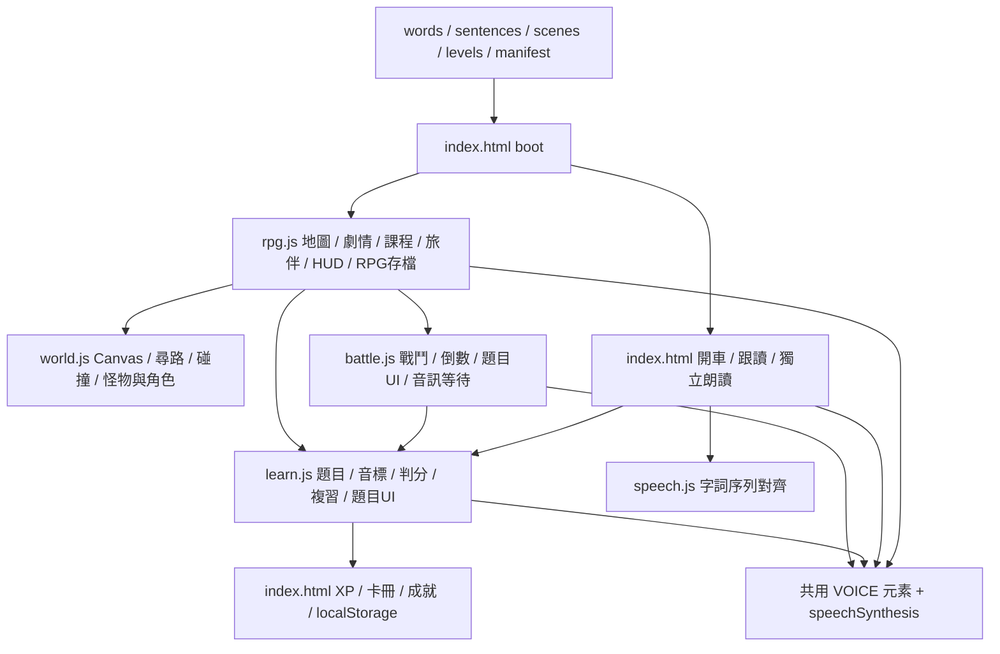

# 全流程架構評審與獨立驗收

評審日期：2026-11-14。固定版本：[`98359dd`](https://github.com/leecien/picture-english/commit/98359dd0652243972c6ab7e6fddf9e2c0a2ffa9d)。

本 PR 只提交評審、重現腳本及證據，**未修改產品程式、main、存檔或 Claude 的分支**。程式修復仍由 Claude 執行。此文件將需求落差、程式缺陷與待實機驗收分開，不將規格留言或自動化通過當成已上線。

## 結論

現有程式已具備場景、旅遊故事、限時戰鬥、旅伴與分段朗讀的基礎，但尚未達到本輪使用者要求的完整試玩標準。主要問題是跨模組的規則沒有共用：

- 同一題在課程、戰鬥與開車模式有不同的播放／揭曉／判分生命週期。
- 舊學習頁的全域樣式覆蓋 RPG，即使新樣式看似已設淺色，深色外觀仍不可讀。
- UI、學習進度與公開試玩版本缺乏同一份可驗證契約。
- 題目完成、課程通過、掌握音素、角色升級混用不同規則，測試未覆蓋所有失敗出口。

因此不建議繼續擴區域或逐頁追加規則。先修共用規則，再重新驗收 KK → 風之旅行 → 開車往返。

## 現有架構



| 模組 | 現況 | 評審建議 |
|---|---|---|
| index.html（1463 行） | 同時包含舊題型、樣式、音訊、收音、開車、存檔與開機 | 先保留相容入口，逐步抽出音訊控制、模式流程與資料寫入；避免一次大重寫 |
| world.js（1912 行） | 畫圖、輸入、尋路、怪物、跟隨、特效 | 保持場景引擎，接收活動／暫停狀態，不決定學習通過 |
| rpg.js（1484 行） | 地圖內容、課程規則、故事、旅伴、選單與存檔集中 | 將課程／關卡定義資料化，控制器不再自行決定音訊和揭曉時機 |
| battle.js（723 行） | 戰鬥、題目渲染、播放等待、倒數及結果混合 | 保留傷害規則；共用題目呈現與可取消的時間／播放生命週期 |
| learn.js（543 行） | 同時輸出 HTML、正解、回饋、記錄與複習 | 分開題目資料、可見內容與結果；不能拿完整答案 HTML 直接當出題UI |
| speech.js（148 行） | 純文字序列對齊與判讀 | 這個分層較清楚；保留，明示不是 KK 音素評分 |
| index 內樣式 + rpg.css + shell.css | 全域狀態類名與兩套主題變數競爭 | 用範圍化的 RPG 元件樣式，色彩成對定義，取消舊全域 !important 影響 |

行數只描述責任集中程度，不單以檔案大小判定品質。

## 已重現的缺陷（先修）

### A1 — 深色外觀使正錯答案不可讀（高優先）

**重現**：同一頁分別使用 light / dark 系統外觀，答錯後查看選項。深色模式正確背景變為 `rgb(23,58,49)`，錯誤背景 `rgb(71,32,42)`，文字皆為 `rgb(47,56,43)`，對比約 **1.02:1 / 1.14:1**。同頁淺色模式為約 10:1。

**根因**：`index.html:110–111` 的全域 `.right/.wrong` 使用 `!important` 與舊主題 `--good-soft/--bad-soft`，覆蓋 `shell.css:411–423`；`.shell button` 則固定深色文字。這不是只有色碼未挑好，也不是已證實由 Android 強制反色造成。

**修法**：限制舊狀態樣式作用域；RPG 的背景、文字、邊框獨立成對；含 disabled 子文字／音標。加勾叉與文字標記。

**驗收**：在兩種外觀的真正渲染結果計算對比，普通文字至少 4.5:1，截圖必須包含判分後狀態。

證據：[深色](evidence/feedback-dark.png)、[淺色](evidence/feedback-light.png)、[數值](evidence/findings.json)。

### A2 — 重聽音訊仍消耗答題時間（高優先）

**重現**：先完成一題聽力播音，再按重播並讓播放保持未完成；倒數從 9.8 降到 9.1 秒。

**根因**：`battle.js:341` 重播只呼叫 `playAwait()`，未凍結倒數與作答狀態。首次播放有等待，重播沒有共用該流程。

**修法**：所有首次播放／重播都進同一播放狀態；成功或失敗後各有明確出口，不能直接在各按鈕內操作共享 VOICE。

**驗收**：聽力未播完或重播時倒數不減；取消／逃跑後舊音訊不能重啟下一題的計時。

### A3 — 答對動畫期間切背景，下一題在背景繼續倒數（高優先）

**重現**：正確作答後立即觸發 `visibilitychange` 隱藏頁面。下一題 turn=2、paused=false，left 從 9.7 降至 9.2。

**根因**：`battle.js hold()` 在 `B.settled` 時直接返回；成功後的 900ms 回呼仍進 `after()` / `ask()`。新題沒有再確認 document.hidden。

**修法**：頁面活動狀態獨立於本題是否已判分；暫停下一題排程／回饋動畫和時鐘。恢復需要玩家確認；用 sessionId + questionId 排除過期回呼。

**驗收**：出題、播音、作答、成功回饋、失敗說明、勝利畫面各階段切背景都測，不只「等待答案時」測一次。

### A4 — 連續答錯仍把課程標為完成（高優先）

**重現**：用新存檔進三音節重音單元 s2，連續點錯（8 題、共 16 次錯誤選擇），`P.correct` 增量為 0，但 `RPG.data.kk.units.s2 === true`。

**根因**：`rpg.js:846` 的 while 在 asked=8 時退出，`856` 無條件寫 `units[u.id]=true`，不管是否達到 ok>=3。

**修法**：區分學過、待補強、獨立完成，不用一個布林值代表全部；離開／題量上限屬暫停，不等於通過。使用者要求正式 review 在通關後才開，因此不要藉由這次修正新增跨日熟練度關卡。

**驗收**：全錯、部分對、夥伴輔助、達標與中途離開各有正確且可恢復的進度。

### A5 — 聽音題洩漏、舊題型仍混入；答錯直接揭曉（高優先）

**重現**：聲音保持未完成，題幹已顯示 `聽 hospital`，播放按鈕含 hospital，兩個選項也已顯示（雖然 disabled）。另一類題直接顯示 `/ʌ/`、圖片、拼字與完整 KK；答錯就把正確選項標綠並顯示完整答案。

**根因**：`Learn.unitQuestion()` 同時產生 which / find，`rpg.js` 課程和戰鬥仍抽舊分支；`Learn.ask()` 與 `Battle.render()/settle()` 各自實作揭曉，預設把答案內容全部塞入 DOM。

**修法**：題型明確分為「音訊 → KK 選擇」和「熟悉圖片 → 音標組合」。共用 preparing / playing / answering / correcting / revealed 狀態。候選音標是合法的作答內容，但不能提前標示哪個正確；題幹、aria-label、答案格及解說也要檢查。

**驗收**：聽音題不放圖片／英文目標／完整答案；播完才出選項並倒數。答錯先保留空格；玩家重試或明確請夥伴協助才補正，輔助不算獨立答對。圖片題不先唸答案。

### A6 — 單字／句子重聽沒有共用元件

**重現**：判分後選項全部 disabled，回饋只有 span，無可操作的單字或整句發音控制（回饋內重播控制數為 0）。雖有「再聽對方說」，播的是 NPC 問句，不是選項的回答句。

**修法**：同一個可見詞彙／句子的發音入口供課程、戰鬥、對話、回饋、卡冊使用；朗讀與提交答案分離。讀完整句及查看單字 KK 分成可辨識操作。未揭曉答案不可因新增入口而洩漏。

**驗收**：正確、錯誤、已停用選項及結果頁都能重聽合法可見文字；不誤提交、不疊音、未提供的 KK 不臆造。

## 尚未實作的明確需求（不能標成完成）

| 要求 | 固定版本的實際狀態 | 處理 |
|---|---|---|
| 41 個 KK 音逐一教學與組合 | `Learn.SOUNDS` 只定義 12 音，6 個對比單元 | 先列完整課程內容表及音檔；完整音素知識不等於幾組辨音 |
| 新手村魔王至少 30 題 | 實際村口 tutorial 泡泡 hp24，Lv.1 玩家正確 3 題即勝利 | 門檻應放在關卡完成條件，不只增加 HP；三個十題階段可儲存 |
| 新手村魔王前取得夥伴 | 取得條件仍是風之旅行行李任務 | 與新手村劇情及舊存檔補領一起調整，不開場附送 |
| 正式 review 通關後開放 | 未畢業即可看到／選擇待複習音 | 對正式 review 入口設通關條件；當題糾正仍保留 |
| 新手村獨立怪物區、多種怪 | KK 圖只定義一種音節泡泡；不同種類在旅行島 | 用已教內容分區，補 3–5 種 novice 怪，不只換 HP |
| 約 Lv.10 挑魔王 | 沒有這個門檻；`Battle.stats()` 用語言 tier 當角色等級 | 先分開冒險等級、語言難度、通關條件。否則 Lv.10 會對應現有最高 B2+、8000 XP，與初級新手村矛盾 |

注意：41 音常見整理為 17 母音＋24 子音；需要完整核對的內容與示範，不應僅為湊數新增符號。Lv.10 是先前提案，尚非已平衡完成的數值。

## 音訊架構與量測

`index.html` 有 `speak/tts`、開車 `clip`，`battle.js` 又有 `playAwait`；四種呼叫共用同一個 VOICE 與 speechSynthesis，卻各自設定事件、超時、速度及聲線。應收斂成有 owner/session、播放完成結果、取消、錯誤與重播規則的共用音訊控制器。播放、等待、收音不應由各畫面自行拼接。

ffmpeg loudnorm 對 8 段既有錄音做讀取量測（沒有改音檔）：

| 檔案 | Integrated LUFS | True peak dBTP |
|---|---:|---:|
| 英文 apple | -21.38 | -6.94 |
| 中文 apple 提示 | -15.19 | -0.19 |
| 英文 my dad drives a car | -22.33 | -7.41 |
| 中文 think | -14.83 | -2.94 |
| 中文 correct | -15.26 | -4.92 |

完整值見 [audio-levels.json](evidence/audio-levels.json)。短錄音量測僅作起始參考，不等於手機實聽或已量測裝置 TTS。樣本中中文提示比英文約高 6–8 LU，能支持使用者回報的落差；相同 volume=1 並不能改善來源差異。中文 apple 的峰值接近 0，但未由此斷言已破音。

修正方向：離線錄音響度匹配與峰值餘量、語音／SFX 分組控制、固定中英文聲線、提示精簡、先播音再收音。聲音自然度需真人聽測，不能只靠測試中的 onend 模擬。

## 發布與版本架構

- 公開 GitHub Pages 目前來源為 main，main 是 `f425442`（PR #1）。
- 已讀取公開網頁 `https://leecien.github.io/picture-english/`，沒有 world.js、shell.css、speech.js，**不是最新 RPG 試玩版**。前面曾將這個網址當作最新試玩入口，這項說明需要更正。
- PR #2 的 HEAD 已是 `98359dd`，但其描述與 artifact 版本標示仍說 `7a98f8c`。這只能確認標示落差，未登入 artifact 獨立核對其實際內嵌程式內容。
- claude.ai 受登入與麥克風限制；平台聽寫不能代替一般手機網頁原生收音驗收。

需要一個可直接打開的 HTTPS 預覽部署，與正式存檔隔離。畫面及報告顯示相同 build SHA、資產版本、部署時間；PR、測試與預覽必須指向同一版。選預覽機制不應持續要求使用者理解 GitHub／部署細節。本次是評審，未修改 GitHub Pages 來源或合併 main。

## 測試結果與盲點

獨立使用系統 Chromium、Playwright、本機 HTTP 執行：

| 現有測試 | 結果 |
|---|---|
| content.cjs | PASS |
| battle.cjs | PASS |
| drive.cjs | PASS |
| story.cjs | PASS |
| companion.cjs | PASS |
| rpg.cjs | PASS |

原始輸出見 evidence/*-suite.log。既有測試有價值，包含相容、故事分支與狀態，但它們大量以音訊 5–30ms 立即結束、模擬語音辨識、讀取正解及測試 hook 驅動流程。這無法覆蓋實際響度、自然語氣、深色樣式、播音前答案可見性、重播消耗時間與成功動畫後切背景。

另以 [audit.cjs](audit.cjs) 記錄上述 A1–A6、全錯完成課程與真實新手教學怪題數。前幾項用受控戰鬥 context 隔離元件；課程與魔王項目走實際地圖／對話 UI。音訊延遲用模擬事件控制，不宣稱已完成真實手機麥克風驗收。腳本只讀取／操作測試瀏覽器內的資料，不改產品檔案。

重跑方式（需可用 Playwright 與 Chromium）：

```sh
# 在含本評審文件的 checkout 中，另建受測版本，勿對 main 跑此腳本
git fetch origin claude/picture-english-game-dev-zl6exi
git worktree add --detach /tmp/picture-audit-src 98359dd0652243972c6ab7e6fddf9e2c0a2ffa9d
python -m http.server 8014 --directory /tmp/picture-audit-src
# 另一個終端機，在含評審文件的 checkout 執行
# 如缺少 runner，可先 npm install --no-save --package-lock=false playwright
node docs/reviews/2026-11-14/audit.cjs
# 腳本目前固定連到 localhost:8014，產物在 /tmp/picture-audit/
```

這是診斷腳本，輸出現況而非斷言產品已合格。修復後請轉成正式回歸斷言，不能將「診斷腳本 exit 0」當作驗收通過。

## 建議修復順序（程式與美術各自同步）

1. **共用題目與答案揭曉狀態**：題型、候選、目標答案、音訊資料分離；先修漏答案與錯誤後自動全亮。
2. **共用音訊與暫停生命週期**：首次播放、重播、跟讀、切背景、取消／錯誤都納入相同狀態；加題目 ID 避免過期回呼。
3. **通過判斷與課程契約**：修全錯過關，落實 41 音、30 題、夥伴時點、怪物區、review 解鎖與獨立冒險等級。保留舊存檔，不把舊紀錄直接當新課程全部掌握。
4. **樣式作用域與共用發音元件**：全畫面修正相同類問題，兩種外觀／手機長短視窗都驗收。
5. **同版本預覽與實機驗收**：先提供免登入網址，再驗證手機收音、音量、觸控。不要繼續擴區域或再製作不會採用的複雜角色圖。

建議逐個可驗收的小提交處理，不一次把舊程式全部換框架。後續只維護這份集中評審及對應修復狀態，不再把每則使用者回報拆成互相矛盾的零散規格留言。
